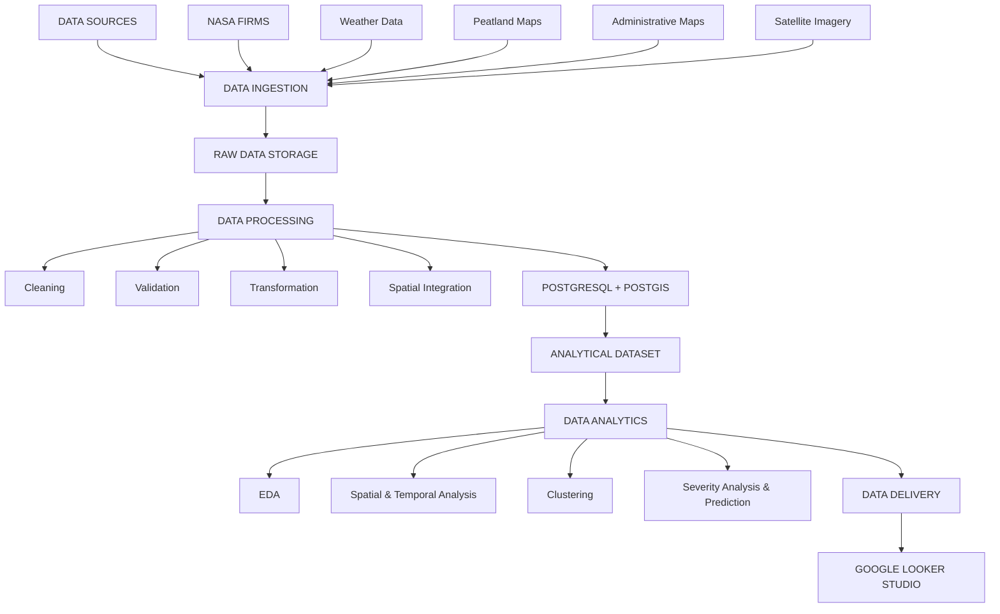

# Spatial-Temporal Clustering & Fire Severity Prediction in Peatland Ecosystems of Kalimantan

**An End-to-End Data Engineering & Geospatial Analytics Project**

## 1. Project Overview

Proyek ini bertujuan untuk menganalisis pola persebaran kebakaran hutan dan lahan (Karhutla) pada ekosistem gambut di Pulau Kalimantan menggunakan pendekatan **Spatial-Temporal Clustering** dan **Fire Severity Analysis & Prediction**.

Penelitian berfokus pada identifikasi pola persebaran titik panas (*hotspots*), pengelompokan wilayah dengan konsentrasi aktivitas kebakaran tinggi, analisis perubahan aktivitas kebakaran berdasarkan waktu, serta eksplorasi faktor lingkungan yang berkaitan dengan kejadian kebakaran.

Selain itu, proyek ini akan mengeksplorasi kemungkinan pengembangan model Machine Learning untuk mengklasifikasikan tingkat keparahan kebakaran berdasarkan ketersediaan dan kualitas data pendukung.

**Main Analysis Period:** 1–30 September 2026.

### Research Area

Cakupan penelitian meliputi lima provinsi di Pulau Kalimantan:

1. Kalimantan Barat
2. Kalimantan Tengah
3. Kalimantan Selatan
4. Kalimantan Timur
5. Kalimantan Utara

### Project Objectives

- Mengumpulkan dan mengintegrasikan data kebakaran, geospasial, lingkungan, dan cuaca.
- Menganalisis distribusi spasial dan temporal titik panas.
- Mengidentifikasi kelompok wilayah dengan konsentrasi hotspot tinggi.
- Menganalisis hubungan antara kondisi lingkungan dan aktivitas kebakaran.
- Mengeksplorasi klasifikasi tingkat keparahan kebakaran berdasarkan data pendukung yang tersedia.
- Menghasilkan visualisasi dan insight mengenai pola Karhutla pada ekosistem gambut.

---

## 2. Project Scope

| Component | Description |
|---|---|
| Domain | Environmental Data Engineering & Geospatial Analytics |
| Main Topic | Forest and Land Fires (Karhutla) |
| Ecosystem | Peatland Ecosystem |
| Geographic Scope | Five Provinces in Kalimantan |
| Main Analysis Period | September 1–30, 2026 |
| Data Engineering | Data Acquisition, Processing, Integration, ETL |
| Data Analytics | EDA, Spatial Analysis, Temporal Analysis, Clustering |
| Machine Learning | Fire Severity Classification, subject to data availability |
| Dashboard | Google Looker Studio |
| Final Output | Integrated Dataset, Geospatial Analysis, Analytical Results, Dashboard |

**Important Note:**

Data historis sebelum September 2026 dapat digunakan untuk membangun dan mengevaluasi model prediksi. September 2026 merupakan periode utama analisis proyek dan dapat digunakan sebagai periode pengujian apabila data target atau ground truth tersedia.

---

## 3. Team Responsibilities

### A. Data Engineer — Sultan Naufal

**Primary Responsibility:** Data acquisition, processing, integration, database management, and data pipeline development.

#### Phase 1 — Data Source Research
- Mengidentifikasi sumber data Karhutla dan data pendukung.
- Memeriksa ketersediaan dan format dataset.
- Mendokumentasikan sumber, lisensi, resolusi, dan cakupan temporal data.
- Menentukan metode pengambilan data.

#### Phase 2 — Data Processing
- Melakukan data profiling.
- Menangani missing values dan duplikasi.
- Melakukan standarisasi format data.
- Memvalidasi koordinat dan tanggal.
- Menyesuaikan sistem koordinat geospasial (CRS).
- Memfilter data berdasarkan wilayah dan periode penelitian.

#### Phase 3 — Data Pipeline Development
- Mengembangkan proses data ingestion.
- Membuat proses extraction, transformation, dan loading.
- Mengintegrasikan data dari berbagai sumber.
- Menambahkan validasi kualitas data.
- Mengimplementasikan logging dan error handling sesuai kebutuhan.
- Menguji konsistensi hasil pipeline.

#### Phase 4 — Database Management
- Merancang struktur database.
- Mengimplementasikan PostgreSQL dan PostGIS.
- Membuat tabel staging dan tabel analitik.
- Mengelola relasi dan spatial index.
- Menyediakan dataset yang siap digunakan Data Analyst.

#### Phase 5 — Documentation & Data Delivery
- Membuat data dictionary.
- Mendokumentasikan sumber dan alur data.
- Menyediakan dataset hasil pemrosesan.
- Melakukan validasi akhir.
- Mendokumentasikan struktur database dan pipeline.

### B. Data Analyst — Daniel Putra

**Primary Responsibility:** Exploratory analysis, spatial-temporal analysis, clustering, predictive modeling, and visualization.

#### Phase 1 — Exploratory Data Analysis
- Memahami struktur dan karakteristik dataset.
- Menganalisis distribusi hotspot.
- Menganalisis jumlah hotspot berdasarkan provinsi.
- Mengidentifikasi tren aktivitas kebakaran berdasarkan tanggal.
- Mengeksplorasi hubungan hotspot dengan kondisi lingkungan.

#### Phase 2 — Spatial Analysis
- Memetakan distribusi hotspot.
- Mengidentifikasi wilayah dengan konsentrasi hotspot tinggi.
- Melakukan overlay hotspot dengan wilayah gambut.
- Menganalisis distribusi berdasarkan wilayah administratif.
- Membuat visualisasi geospasial.

#### Phase 3 — Spatial-Temporal Clustering
- Menentukan variabel clustering.
- Melakukan preprocessing.
- Mengevaluasi penggunaan DBSCAN.
- Menentukan parameter clustering.
- Menganalisis distribusi dan perubahan cluster berdasarkan waktu.
- Menginterpretasikan hasil clustering.

#### Phase 4 — Fire Severity Analysis & Prediction
- Memeriksa ketersediaan data untuk menentukan target severity.
- Menentukan fitur prediksi.
- Melakukan feature engineering.
- Mengembangkan model klasifikasi apabila label target tersedia dan valid.
- Mengevaluasi model menggunakan metrik yang sesuai.
- Menginterpretasikan hasil model.

#### Phase 5 — Visualization & Reporting
- Membuat peta distribusi hotspot.
- Memvisualisasikan hasil clustering.
- Membuat grafik temporal.
- Membuat visualisasi analisis severity.
- Mengembangkan dashboard menggunakan Google Looker Studio.
- Menyusun insight dan laporan akhir.

### Shared Responsibilities

- Menentukan kebutuhan dan format data.
- Menyepakati struktur dataset.
- Melakukan integrasi Data Engineering dan Data Analytics.
- Melakukan validasi hasil akhir.
- Menyusun dokumentasi dan laporan proyek.

---

## 4. Data Sources

Sumber data berikut merupakan kandidat yang akan dievaluasi berdasarkan ketersediaan, kualitas, lisensi, dan kesesuaian periode penelitian.

| Dataset | Candidate Source | Purpose |
|---|---|---|
| Fire Hotspots | NASA FIRMS | Identifikasi titik panas |
| Administrative Boundaries | BIG / GADM | Batas wilayah administratif |
| Peatland Distribution | KLHK / BRGM / BIG | Identifikasi wilayah gambut |
| Rainfall | CHIRPS | Analisis curah hujan |
| Weather Variables | ERA5 / ERA5-Land | Data cuaca |
| Satellite Imagery | Sentinel-2 | Analisis area terbakar dan severity |
| Land Cover | ESA WorldCover | Informasi tutupan lahan |

### Data Source Links

- NASA FIRMS: https://firms.modaps.eosdis.nasa.gov/
- Google Earth Engine: https://earthengine.google.com/
- Copernicus Data Space: https://dataspace.copernicus.eu/
- CHIRPS: https://www.chc.ucsb.edu/data/chirps
- ERA5: https://cds.climate.copernicus.eu/
- BIG: https://tanahair.indonesia.go.id/
- GADM: https://gadm.org/
- ESA WorldCover: https://worldcover2021.esa.int/

**Note:** Tidak semua sumber data harus digunakan. Pemilihan akhir akan mengikuti hasil eksplorasi dan validasi ketersediaan dataset.

---

## 5. Technology Stack

Technology stack disusun berdasarkan kebutuhan proyek. Tools yang bersifat opsional hanya akan digunakan apabila memang diperlukan.

### Data Engineering

| Technology | Purpose | Status |
|---|---|---|
| Python | Main programming language | Planned |
| Pandas | Data manipulation | Planned |
| NumPy | Numerical processing | Planned |
| GeoPandas | Geospatial processing | Planned |
| Shapely | Geometry operations | Planned |
| Rasterio | Raster processing | As needed |
| SQL | Database queries | Planned |
| PostgreSQL | Relational database | Selected |
| PostGIS | Spatial database extension | Selected |
| Prefect | Workflow orchestration | Optional |
| Docker | Environment management | Optional |
| Git & GitHub | Version control | Used |

### Data Analytics & Machine Learning

| Technology | Purpose |
|---|---|
| Python | Data analysis |
| Pandas & NumPy | Data manipulation |
| GeoPandas | Spatial analysis |
| Scikit-learn | Clustering and machine learning |
| DBSCAN | Spatial clustering |
| Random Forest | Candidate classification model |
| XGBoost | Candidate comparison model |
| Matplotlib / Seaborn | Data visualization |
| Folium | Interactive geospatial maps |

### Dashboard & Supporting Tools

| Tool | Purpose |
|---|---|
| Google Looker Studio | Analytical dashboard |
| Google Sheets | Possible dashboard data source |
| BigQuery | Optional analytical data delivery |
| VS Code | Development environment |
| DBeaver | Database management |
| QGIS | Geospatial data inspection |
| Jupyter Notebook / Google Colab | Data exploration and experimentation |

---

## 6. System Architecture

The project follows an end-to-end data workflow consisting of data acquisition, processing, storage, analytics, and visualization.



### Architecture Explanation

1. **Data Sources:** Mengambil data dari sumber eksternal.
2. **Data Ingestion:** Mengumpulkan data melalui API, download, atau metode lain.
3. **Raw Data Storage:** Menyimpan salinan data sumber sebelum transformasi.
4. **Data Processing:** Melakukan cleaning, validasi, standardisasi, dan integrasi.
5. **Database:** Menyimpan data terstruktur menggunakan PostgreSQL dan PostGIS.
6. **Analytical Dataset:** Menyediakan data yang sudah diproses untuk analisis.
7. **Data Analytics:** Melakukan EDA, analisis spasial-temporal, clustering, dan pemodelan.
8. **Data Delivery:** Menyediakan hasil analisis untuk dashboard.
9. **Visualization:** Menampilkan hasil menggunakan Google Looker Studio.

*Architecture ini merupakan rancangan awal dan dapat berubah mengikuti implementasi.*

---

## 7. Proposed Database Design

Database direncanakan menggunakan PostgreSQL dan PostGIS untuk mendukung penyimpanan data tabular dan geospasial.

Struktur tabel akan ditentukan setelah proses data profiling dan analisis kebutuhan data.

### Initial Data Categories

| Data Category | Description |
|---|---|
| Hotspot | Informasi deteksi titik panas |
| Weather | Informasi kondisi cuaca |
| Peatland | Informasi area ekosistem gambut |
| Administrative | Informasi wilayah administratif |
| Land Cover | Informasi tutupan lahan |
| Burned Area | Informasi area terbakar dan severity jika tersedia |

### Proposed Data Flow

`Raw Data → Staging → Data Cleaning → Data Integration → PostgreSQL/PostGIS → Analytical Dataset`

---

## 8. Proposed Analytical Methods

Metode analisis akan disesuaikan dengan karakteristik dan ketersediaan data.

| Method | Purpose | Responsible |
|---|---|---|
| Data Profiling | Memahami kualitas data | Data Engineer |
| ETL | Pengolahan dan integrasi data | Data Engineer |
| Spatial Overlay | Analisis hubungan hotspot dan gambut | Shared |
| EDA | Memahami karakteristik data | Data Analyst |
| Spatial Analysis | Menganalisis distribusi geografis | Data Analyst |
| Temporal Analysis | Menganalisis pola waktu | Data Analyst |
| DBSCAN | Mengidentifikasi cluster hotspot | Data Analyst |
| Random Forest | Kandidat model klasifikasi | Data Analyst |
| XGBoost | Kandidat model pembanding | Data Analyst |

---

## 9. Important Methodological Considerations

### 1. Hotspot is not the same as fire severity

Data hotspot NASA FIRMS merupakan deteksi anomali termal, bukan pengukuran langsung tingkat keparahan kebakaran.

Diperlukan data tambahan seperti Sentinel-2 untuk memperoleh informasi area terbakar dan membentuk label severity yang dapat dipertanggungjawabkan.

### 2. Temporal clustering

Clustering perlu mempertimbangkan koordinat dan waktu kejadian. Pemilihan metode jarak dan parameter harus disesuaikan dengan karakteristik data.

### 3. Severity prediction

Model klasifikasi severity hanya dikembangkan apabila target label tersedia, valid, dan memiliki dasar metodologi yang jelas.

### 4. Model validation

Pembagian data perlu mempertimbangkan urutan waktu untuk mengurangi risiko data leakage.

### 5. Data availability

Ketersediaan data, resolusi spasial, temporal coverage, dan kualitas sumber akan memengaruhi metode analisis yang dapat diterapkan.

---

## 10. Repository Structure

```text
karhutla-spatial-temporal-analysis/
│
├── README.md
├── requirements.txt
├── .gitignore
├── LICENSE
│
├── data/
│   ├── README.md
│   ├── raw/
│   ├── staging/
│   ├── processed/
│   └── final/
│
├── data_engineering/
│   ├── ingestion/
│   ├── transformation/
│   ├── validation/
│   ├── pipelines/
│   └── sql/
│
├── data_analytics/
│   ├── notebooks/
│   ├── clustering/
│   ├── modeling/
│   ├── evaluation/
│   └── visualization/
│
├── database/
│   ├── schema/
│   ├── staging/
│   ├── analytical_mart/
│   └── README.md
│
├── dashboard/
│   ├── README.md
│   ├── looker_studio/
│   │   ├── README.md
│   │   ├── screenshots/
│   │   └── dashboard_links.md
│   └── exports/
│
├── docs/
│   ├── architecture/
│   ├── data_dictionary/
│   ├── methodology/
│   └── reports/
│
├── tests/
│
└── .github/
    └── ISSUE_TEMPLATE/
```

---

## 11. Project Milestones

Estimated development timeline: 6–8 weeks.

| Phase | Data Engineer | Data Analyst |
|---|---|---|
| 1. Research | Data source research | Methodology research |
| 2. Acquisition | Data ingestion | Initial data exploration |
| 3. Processing | Cleaning and transformation | EDA and spatial analysis |
| 4. Database | Database development | Clustering |
| 5. Integration | Analytical dataset delivery | Feature engineering |
| 6. Development | Pipeline testing | Predictive modeling |
| 7. Visualization | Data delivery | Dashboard development |
| 8. Finalization | Documentation and integration | Evaluation and reporting |

*Timeline merupakan estimasi dan dapat berubah mengikuti ketersediaan data serta kompleksitas pengolahan.*

---

## 12. Definition of Done

### Data Engineering
- [ ] Data sources telah diidentifikasi dan didokumentasikan.
- [ ] Dataset utama berhasil dikumpulkan.
- [ ] Data telah melalui proses cleaning dan validasi.
- [ ] Database berhasil diimplementasikan.
- [ ] Analytical dataset tersedia.
- [ ] Pipeline dapat dijalankan dan diuji.
- [ ] Dokumentasi teknis tersedia.

### Data Analytics
- [ ] EDA selesai.
- [ ] Spatial analysis selesai.
- [ ] Temporal analysis selesai.
- [ ] Clustering dilakukan dan dievaluasi.
- [ ] Severity analysis dilakukan.
- [ ] Model prediksi dikembangkan jika target data tersedia.
- [ ] Dashboard selesai.
- [ ] Laporan hasil analisis tersedia.

### Final Integration
- [ ] Data Engineering dan Data Analytics terintegrasi.
- [ ] Kode dan dokumentasi tersedia di GitHub.
- [ ] Hasil proyek dapat direproduksi.
- [ ] Seluruh hasil telah melalui validasi.

---

## 13. Expected Final Deliverables

1. Data Collection and Processing Pipeline.
2. PostgreSQL + PostGIS Geospatial Database.
3. Integrated Analytical Dataset.
4. Spatial-Temporal Clustering Results.
5. Fire Severity Analysis and Prediction, subject to data availability.
6. Google Looker Studio Dashboard.
7. Technical Documentation.
8. Final Analytical Report.

---

## 14. Team

| Name | Role | Main Responsibility |
|---|---|---|
| Sultan Naufal | Data Engineer | Data Acquisition, ETL, Database, Data Integration |
| Daniel Putra | Data Analyst | EDA, Spatial Analysis, Clustering, Machine Learning, Visualization |

---

**Project Status:** In Progress

**Project Domain:** Environmental Data Engineering & Geospatial Analytics

**Main Analysis Period:** September 2026

**Project Location:** Kalimantan, Indonesia

**Project Goal:** Developing an end-to-end data solution to analyze spatial-temporal fire patterns and investigate fire severity in peatland ecosystems across Kalimantan.