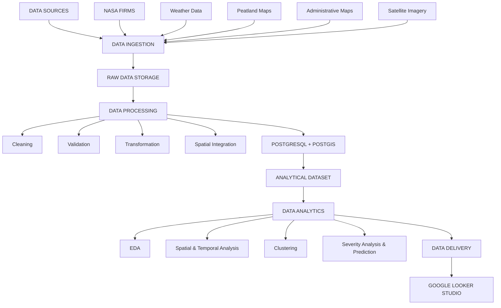

# Spatial-Temporal Clustering & Fire Severity Prediction in Peatland Ecosystems of Kalimantan

**An End-to-End Data Engineering & Geospatial Analytics Project**

## 1. Project Overview

Proyek ini bertujuan untuk menganalisis pola persebaran kebakaran hutan dan lahan (Karhutla) pada ekosistem gambut di Pulau Kalimantan menggunakan pendekatan **Spatial-Temporal Clustering** dan **Fire Severity Analysis & Prediction**.

Penelitian berfokus pada identifikasi pola persebaran titik panas (*hotspots*), pengelompokan wilayah dengan konsentrasi aktivitas kebakaran tinggi, analisis perubahan aktivitas kebakaran berdasarkan waktu, serta eksplorasi faktor lingkungan yang berkaitan dengan kejadian kebakaran.

Selain itu, proyek ini akan mengeksplorasi kemungkinan pengembangan model Machine Learning untuk mengklasifikasikan tingkat keparahan kebakaran berdasarkan ketersediaan dan kualitas data pendukung.

**Main Analysis Period:** September 1–30, 2026.

### Research Area

Cakupan penelitian meliputi lima provinsi di Pulau Kalimantan:

1. Kalimantan Barat
2. Kalimantan Tengah
3. Kalimantan Selatan
4. Kalimantan Timur
5. Kalimantan Utara

### Project Objectives

- Mengumpulkan dan mengintegrasikan data kebakaran, geospasial, lingkungan, dan cuaca.
- Menganalisis distribusi spasial dan temporal titik panas.
- Mengidentifikasi kelompok wilayah dengan konsentrasi hotspot tinggi.
- Menganalisis hubungan antara kondisi lingkungan dan aktivitas kebakaran.
- Mengeksplorasi klasifikasi tingkat keparahan kebakaran berdasarkan data pendukung yang tersedia.
- Menghasilkan visualisasi dan insight mengenai pola Karhutla pada ekosistem gambut.

---

## 2. Project Scope

| Component | Description |
|---|---|
| Domain | Environmental Data Engineering & Geospatial Analytics |
| Main Topic | Forest and Land Fires (Karhutla) |
| Ecosystem | Peatland Ecosystem |
| Geographic Scope | Five Provinces in Kalimantan |
| Main Analysis Period | September 1–30, 2026 |
| Data Engineering | Data Acquisition, Processing, Integration, ETL |
| Data Analytics | EDA, Spatial Analysis, Temporal Analysis, Clustering |
| Machine Learning | Fire Severity Classification, subject to data availability |
| Dashboard | Google Looker Studio |
| Final Output | Integrated Dataset, Geospatial Analysis, Analytical Results, Dashboard |

**Important Note:**

Data historis sebelum September 2026 dapat digunakan untuk membangun dan mengevaluasi model prediksi. September 2026 merupakan periode utama analisis proyek dan dapat digunakan sebagai periode pengujian apabila data target atau ground truth tersedia.

---

## 3. Team Responsibilities

### A. Data Engineer — Sultan Naufal

**Primary Responsibility:** Data acquisition, processing, integration, database management, and data pipeline development.

#### Phase 1 — Data Source Research

- Mengidentifikasi sumber data Karhutla dan data pendukung.
- Memeriksa ketersediaan dan format dataset.
- Mendokumentasikan sumber, lisensi, resolusi, dan cakupan temporal data.
- Menentukan metode pengambilan data.

#### Phase 2 — Data Processing

- Melakukan data profiling.
- Menangani missing values dan duplikasi.
- Mengidentifikasi anomali data.
- Memastikan konsistensi satuan pengukuran.
- Mempertahankan data mentah sebagai sumber awal (*raw data preservation*).
- Melakukan standarisasi format data.
- Memvalidasi koordinat dan tanggal.
- Menyesuaikan sistem koordinat geospasial (CRS).
- Memfilter data berdasarkan wilayah dan periode penelitian.

#### Phase 3 — Data Pipeline Development

- Mengembangkan proses data ingestion.
- Membuat proses extraction, transformation, dan loading.
- Mengintegrasikan data dari berbagai sumber.
- Menambahkan validasi kualitas data.
- Mengimplementasikan logging dan error handling sesuai kebutuhan.
- Menguji konsistensi hasil pipeline.

#### Phase 4 — Database Management

- Merancang struktur database.
- Mengimplementasikan PostgreSQL dan PostGIS.
- Menentukan tipe data dan constraint tabel.
- Mengoptimalkan query database sesuai kebutuhan.
- Menentukan struktur penyimpanan data spasial.
- Membuat tabel staging dan tabel analitik.
- Mengelola relasi dan spatial index.
- Menyediakan dataset yang siap digunakan Data Analyst.

#### Phase 5 — Documentation & Data Delivery

- Membuat data dictionary.
- Mendokumentasikan sumber dan alur data.
- Menyediakan dataset hasil pemrosesan.
- Melakukan validasi akhir.
- Mendokumentasikan struktur database dan pipeline.

### B. Data Analyst — Daniel Putra

**Primary Responsibility:** Exploratory analysis, spatial-temporal analysis, clustering, predictive modeling, and visualization.

#### Phase 1 — Exploratory Data Analysis

- Memahami struktur dan karakteristik dataset.
- Menganalisis distribusi hotspot.
- Menganalisis jumlah hotspot berdasarkan provinsi.
- Mengidentifikasi tren aktivitas kebakaran berdasarkan tanggal.
- Mengeksplorasi hubungan hotspot dengan kondisi lingkungan.

#### Phase 2 — Spatial Analysis

- Memetakan distribusi hotspot.
- Mengidentifikasi wilayah dengan konsentrasi hotspot tinggi.
- Melakukan overlay hotspot dengan wilayah gambut.
- Menganalisis distribusi berdasarkan wilayah administratif.
- Membuat visualisasi geospasial.

#### Phase 3 — Spatial-Temporal Clustering

- Menentukan variabel clustering.
- Melakukan preprocessing.
- Mengevaluasi penggunaan DBSCAN.
- Menentukan parameter clustering.
- Menganalisis distribusi dan perubahan cluster berdasarkan waktu.
- Menginterpretasikan hasil clustering.

#### Phase 4 — Fire Severity Analysis & Prediction

- Memeriksa ketersediaan data untuk menentukan target severity.
- Menentukan fitur prediksi.
- Melakukan feature engineering.
- Mengembangkan model klasifikasi apabila label target tersedia dan valid.
- Mengevaluasi model menggunakan metrik yang sesuai.
- Menginterpretasikan hasil model.

#### Phase 5 — Visualization & Reporting

- Membuat peta distribusi hotspot.
- Memvisualisasikan hasil clustering.
- Membuat grafik temporal.
- Membuat visualisasi analisis severity.
- Mengembangkan dashboard menggunakan Google Looker Studio.
- Menyusun insight dan laporan akhir.

### Shared Responsibilities

- Menentukan kebutuhan dan format data.
- Menyepakati struktur dataset.
- Melakukan integrasi Data Engineering dan Data Analytics.
- Melakukan validasi hasil akhir.
- Menyusun dokumentasi dan laporan proyek.

---

## 4. Data Sources

Sumber data dipilih berdasarkan ketersediaan, kualitas, lisensi, resolusi spasial, dan kesesuaian periode penelitian.

### Data Sources and Current Status

| Dataset | Source | Purpose | Status |
|---|---|---|---|
| Fire Hotspots | NASA FIRMS | Identifikasi titik panas | Processed |
| Administrative Boundaries | BIG | Batas wilayah administratif | Processed |
| Peatland Distribution | BNPB InAWARE / Global Forest Watch | Identifikasi area gambut | Processed |
| Rainfall | CHIRPS | Analisis curah hujan | Planned |
| Weather Variables | ERA5 / ERA5-Land | Data cuaca | Planned |
| Satellite Imagery | Sentinel-2 | Analisis area terbakar dan severity | Planned |
| Land Cover | ESA WorldCover | Informasi tutupan lahan | Planned |

### Data Source Links

- NASA FIRMS: https://firms.modaps.eosdis.nasa.gov/
- BNPB GIS: https://gis.bnpb.go.id/
- Google Earth Engine: https://earthengine.google.com/
- Copernicus Data Space: https://dataspace.copernicus.eu/
- CHIRPS: https://www.chc.ucsb.edu/data/chirps
- ERA5: https://cds.climate.copernicus.eu/
- BIG: https://tanahair.indonesia.go.id/
- GADM: https://gadm.org/
- ESA WorldCover: https://worldcover2021.esa.int/

### Data Source Notes

**NASA FIRMS**

Menggunakan data VIIRS Suomi-NPP dengan produk near real-time (NRT). Dataset mentah mencakup periode September–Oktober 2026, kemudian difilter untuk mendapatkan data periode utama penelitian, yaitu September 2026.

**Administrative Boundaries**

Menggunakan data batas administrasi dari BIG sebagai acuan wilayah penelitian untuk lima provinsi di Kalimantan.

**Peatland Distribution**

Menggunakan layer `Indonesia_peat_lands` dari BNPB InAWARE / Global Forest Watch. Dataset ini digunakan sebagai alternatif karena akses terhadap layanan peta gambut Kementerian Pertanian yang ditelusuri sebelumnya memerlukan autentikasi.

Data gambut yang digunakan merupakan hasil pengambilan berdasarkan bounding box Kalimantan dan belum merupakan hasil clipping terhadap batas provinsi. Informasi atribut dan tahun pembaruan sumber perlu diperhatikan ketika melakukan interpretasi.

**Important:** Tidak semua sumber data harus digunakan. Pemilihan akhir akan mengikuti hasil eksplorasi dan validasi ketersediaan dataset.

## 5. Current Data Engineering Progress

Bagian ini mendokumentasikan dataset yang telah dikumpulkan, diproses, dimuat ke database, dan divalidasi.

### A. Administrative Boundaries

| Attribute | Result |
|---|---|
| Source | BIG |
| Geographic Coverage | Five Kalimantan Provinces |
| Number of Provinces | 5 |
| CRS | EPSG:4326 |
| Geometry Type | MultiPolygon |
| Database Table | `karhutla.dim_provinces` |
| Status | Loaded and validated |

### B. NASA FIRMS Hotspots

| Attribute | Result |
|---|---|
| Source | NASA FIRMS |
| Satellite | Suomi-NPP |
| Instrument | VIIRS |
| Product Version | 2.0NRT |
| Raw Records | 210,915 |
| Raw Date Range | September 1 – October 31, 2026 |
| September Records | 115,739 |
| Records Within Study Area | 115,137 |
| Unmatched Records | 602 |
| CRS | EPSG:4326 |
| Database Table | `karhutla.fact_hotspots` |
| Status | Loaded and validated |

The 602 unmatched records are retained separately for further inspection. They are not automatically classified as detections outside Indonesia.

### C. Peatland Dataset

| Attribute | Result |
|---|---|
| Source | BNPB InAWARE / Global Forest Watch |
| Layer | `Indonesia_peat_lands` |
| Raw Features | 350 |
| Geometry Types | Polygon and MultiPolygon |
| CRS | EPSG:4326 |
| Valid Geometries | 350 |
| Unique Features | 350 |
| Normalized Category | 348 gambut, 2 unknown |
| Province Relationships | 353 |
| Database Table | `karhutla.dim_peatlands` |
| Status | Loaded and validated |

The peatland polygons were not clipped to provincial boundaries. The province relationship table records spatial intersections between peatland features and administrative boundaries. Three peatland features intersect more than one province, resulting in 353 relationships from 350 unique features.

### D. CHIRPS Rainfall Data

| Attribute | Result |
|---|---|
| Source | CHIRPS |
| Data Type | Daily Raster |
| Period | September 1–30, 2026 |
| Number of Raster Files | 30 |
| CRS | EPSG:4326 |
| Raster Dimensions | 210 × 188 pixels |
| Number of Bands | 1 |
| Spatial Resolution | 0.05° × 0.05° |
| NoData Value | -9999 |
| Storage | GeoTIFF files |
| Database Table | `karhutla.chirps_raster_metadata` |
| Status | Metadata loaded and validated |

The raster files remain stored as GeoTIFF files on disk. PostgreSQL stores their metadata and file references rather than individual raster pixels.

### E. Sentinel-2 Data

| Attribute | Result |
|---|---|
| Source | Copernicus Data Space |
| Satellite | Sentinel-2 |
| Instrument | MSI |
| Processing Level | L2A |
| Period | September 1–30, 2026 |
| Product Footprints | 214 |
| Geometry Type | Polygon |
| CRS | EPSG:4326 |
| Average Product Cloud Cover | 16.67% |
| Database Table | `karhutla.sentinel2_products` |
| Status | Metadata and footprints loaded and validated |

The current implementation stores Sentinel-2 product metadata and spatial footprints. The actual satellite imagery has not yet been downloaded or processed for burned-area and severity analysis.

### F. Database Implementation

| Attribute | Result |
|---|---|
| Database | `karhutla_db` |
| DBMS | PostgreSQL 18.6 |
| Spatial Extension | PostGIS 3.7.0 |
| Schema | `karhutla` |
| Number of Tables | 5 |
| Total Records | 115,736 |
| Spatial Reference System | EPSG:4326 |
| Spatial Index | GiST |
| Backup Format | PostgreSQL Custom Format |
| Status | Implemented and validated |

Database tables:

| Table | Records |
|---|---:|
| `dim_provinces` | 5 |
| `dim_peatlands` | 350 |
| `fact_hotspots` | 115,137 |
| `sentinel2_products` | 214 |
| `chirps_raster_metadata` | 30 |
| **Total** | **115,736** |

### G. Database Validation

- All 115,137 hotspot records have valid province references.
- No invalid province references were found.
- All 115,706 spatial features have valid geometries.
- All geometry tables use EPSG:4326.
- GiST spatial indexes have been created for all four spatial tables.
- Database backup has been created and its archive contents inspected.
- Actual database restoration test is still pending.

### Data Engineering Summary

| Dataset | Processing | Database Loading | Validation |
|---|---|---|---|
| Administrative Boundaries | Completed | Completed | Passed |
| NASA FIRMS | Completed | Completed | Passed |
| Peatland | Completed | Completed | Passed |
| CHIRPS | Completed | Completed | Passed |
| Sentinel-2 Metadata | Completed | Completed | Passed |
| ERA5 / Weather | Pending | Pending | Pending |
| Land Cover | Pending | Pending | Pending |

**Current Status:** Initial data acquisition, processing, database implementation, loading, and validation have been completed for the five datasets listed above.

## 6. Technology Stack

Technology stack disusun berdasarkan kebutuhan proyek. Tools yang bersifat opsional hanya akan digunakan apabila memang diperlukan.

### Data Engineering

| Technology | Purpose | Status |
|---|---|---|
| Python | Main programming language | Used |
| Pandas | Data manipulation | Used |
| NumPy | Numerical processing | Used |
| GeoPandas | Geospatial processing | Used |
| Shapely | Geometry operations | Used |
| Pyogrio / Fiona | Geospatial file I/O | As needed |
| Requests | API data acquisition | Used |
| Rasterio | Raster processing | As needed |
| SQL | Database queries | Planned |
| PostgreSQL | Relational database | Selected |
| PostGIS | Spatial database extension | Selected |
| Prefect | Workflow orchestration | Optional |
| Docker | Environment management | Optional |
| Git & GitHub | Version control | Used |

### Data Analytics & Machine Learning

| Technology | Purpose |
|---|---|
| Python | Data analysis |
| Pandas & NumPy | Data manipulation |
| GeoPandas | Spatial analysis |
| Scikit-learn | Clustering and machine learning |
| DBSCAN | Spatial clustering |
| Random Forest | Candidate classification model |
| XGBoost | Candidate comparison model |
| Matplotlib / Seaborn | Data visualization |
| Folium | Interactive geospatial maps |

### Dashboard & Supporting Tools

| Tool | Purpose |
|---|---|
| Google Looker Studio | Analytical dashboard |
| Google Sheets | Possible dashboard data source |
| BigQuery | Optional analytical data delivery |
| VS Code | Development environment |
| DBeaver | Database management |
| QGIS | Geospatial data inspection |
| Jupyter Notebook / Google Colab | Data exploration and experimentation |

---

## 7. System Architecture

The project follows an end-to-end data workflow consisting of data acquisition, processing, storage, analytics, and visualization.


**Architecture Status:** The initial data engineering architecture has been implemented for administrative boundaries, FIRMS hotspots, peatland data, CHIRPS raster metadata, and Sentinel-2 product metadata and footprints.

The PostgreSQL/PostGIS database has been created and populated with five tables. Initial data validation, spatial integrity checks, indexing, and database backup have also been completed.

The following stages remain in progress:
- Database restoration testing.
- Analytical dataset preparation and delivery.
- End-to-end pipeline orchestration and testing.
- Data Analyst integration.
- Dashboard development and final visualization.

---

## 8. Database Design and Implementation

The project uses PostgreSQL 18.6 with PostGIS 3.7.0 to store and manage tabular and geospatial datasets.

The database is named `karhutla_db`, with the primary project schema named `karhutla`.

### Implemented Database Tables

| Table | Description |
|---|---|
| `karhutla.dim_provinces` | Administrative boundaries of five Kalimantan provinces |
| `karhutla.dim_peatlands` | Peatland polygon features and source attributes |
| `karhutla.fact_hotspots` | NASA FIRMS hotspot detections |
| `karhutla.sentinel2_products` | Sentinel-2 product metadata and spatial footprints |
| `karhutla.chirps_raster_metadata` | Metadata and file references for daily CHIRPS raster datasets |

### Database Implementation

- Primary keys and unique constraints.
- Foreign key relationship between hotspot records and provinces.
- Geometry columns using EPSG:4326.
- GiST spatial indexes for spatial tables.
- B-tree indexes for frequently queried attributes.
- Check constraints for applicable fields.
- Database backup using PostgreSQL custom format.

### Data Storage Strategy

Vector datasets are stored in PostGIS geometry columns.

CHIRPS raster files remain stored as GeoTIFF files on disk, while their metadata and file references are maintained in PostgreSQL.

Sentinel-2 imagery is not yet stored in the database. The current database contains product metadata and spatial footprints.

### Next Steps

- Perform database restoration testing.
- Prepare analytical datasets for downstream analysis.
- Develop repeatable data pipelines.
- Document database relationships and data dictionary.
- Deliver validated data to the Data Analyst.

**Database Status:** Implemented, populated, and initially validated.

---

## 9. Proposed Analytical Methods

Metode analisis akan disesuaikan dengan karakteristik dan ketersediaan data.

| Method | Purpose | Responsible |
|---|---|---|
| Data Profiling | Memahami kualitas data | Data Engineer |
| ETL | Pengolahan dan integrasi data | Data Engineer |
| Spatial Overlay | Analisis hubungan hotspot dan gambut | Shared |
| EDA | Memahami karakteristik data | Data Analyst |
| Spatial Analysis | Menganalisis distribusi geografis | Data Analyst |
| Temporal Analysis | Menganalisis pola waktu | Data Analyst |
| DBSCAN | Mengidentifikasi cluster hotspot | Data Analyst |
| Random Forest | Kandidat model klasifikasi | Data Analyst |
| XGBoost | Kandidat model pembanding | Data Analyst |

---

## 10. Important Methodological Considerations

### 1. Hotspot is not the same as fire severity

Data hotspot NASA FIRMS merupakan deteksi anomali termal, bukan pengukuran langsung tingkat keparahan kebakaran.

Diperlukan data tambahan seperti Sentinel-2 untuk memperoleh informasi perubahan vegetasi atau area terbakar dan membentuk label severity yang dapat dipertanggungjawabkan.

### 2. Peatland data limitations

Dataset gambut yang digunakan merupakan alternatif dari layer BNPB InAWARE / Global Forest Watch. Dataset ini tidak boleh langsung dianggap setara dengan peta gambut skala 1:50.000 dari Kementerian Pertanian.

Tahun pembaruan, definisi atribut, dan ketelitian spasial sumber perlu dipertimbangkan dalam interpretasi hasil.

### 3. Temporal clustering

Clustering perlu mempertimbangkan koordinat dan waktu kejadian. Pemilihan metode jarak dan parameter harus disesuaikan dengan karakteristik data.

### 4. Severity prediction

Model klasifikasi severity hanya dikembangkan apabila target label tersedia, valid, dan memiliki dasar metodologi yang jelas.

### 5. Model validation

Pembagian data perlu mempertimbangkan urutan waktu untuk mengurangi risiko data leakage.

### 6. Data availability

Ketersediaan data, resolusi spasial, temporal coverage, dan kualitas sumber akan memengaruhi metode analisis yang dapat diterapkan.

---

## 11. Repository Structure

The repository is organized into dedicated directories for data storage, data engineering, data analytics, database management, documentation, and dashboard development.

```text
karhutla-spatial-temporal-analysis/
│
├── README.md
├── requirements.txt
├── .gitignore
├── LICENSE
│
├── dashboard/
│   └── exports/
│
├── data/
│   ├── raw/
│   │   ├── boundaries/
│   │   ├── chirps/
│   │   ├── firms/
│   │   ├── peatland/
│   │   └── sentinel2/
│   │
│   ├── staging/
│   │   └── sentinel2/
│   │
│   ├── processed/
│   │   ├── boundaries/
│   │   ├── chirps/
│   │   │   └── daily/
│   │   ├── firms/
│   │   └── peatland/
│   │
│   └── final/
│
├── database/
│   ├── backup/
│   ├── schema/
│   ├── staging/
│   └── analytical_mart/
│
├── data_engineering/
│   ├── ingestion/
│   ├── transformation/
│   ├── validation/
│   ├── pipelines/
│   │
│   ├── database/
│   │   ├── scripts/
│   │   └── sql/
│   │
│   └── sql/
│
├── data_analytics/
│   ├── notebooks/
│   ├── clustering/
│   ├── modeling/
│   ├── evaluation/
│   └── visualization/
│
├── docs/
│   ├── architecture/
│   ├── data_dictionary/
│   ├── methodology/
│   └── reports/
│
└── tests/
```

### Directory Description

| Directory | Description |
|---|---|
| `data/raw/` | Original datasets collected from external sources, preserved in their original form. |
| `data/staging/` | Intermediate datasets prepared for processing and integration. |
| `data/processed/` | Cleaned, transformed, and validated datasets. |
| `data/final/` | Final datasets prepared for analytical consumption and delivery. |
| `database/backup/` | Database backup files. |
| `database/schema/` | Database schema definitions and SQL scripts. |
| `database/staging/` | Database staging objects and intermediate data. |
| `database/analytical_mart/` | Analytical tables and datasets prepared for downstream analysis. |
| `data_engineering/ingestion/` | Scripts for acquiring data from external sources. |
| `data_engineering/transformation/` | Scripts and notebooks for data cleaning and transformation. |
| `data_engineering/validation/` | Data quality checks and validation procedures. |
| `data_engineering/pipelines/` | Data pipeline implementation and workflow orchestration. |
| `data_engineering/database/scripts/` | Python scripts for loading datasets into PostgreSQL/PostGIS. |
| `data_engineering/database/sql/` | SQL scripts used for database implementation and management. |
| `data_engineering/sql/` | Additional SQL queries and data processing scripts. |
| `data_analytics/notebooks/` | Notebooks for exploratory data analysis and experimentation. |
| `data_analytics/clustering/` | Spatial and temporal clustering implementation. |
| `data_analytics/modeling/` | Machine learning model development. |
| `data_analytics/evaluation/` | Model evaluation and performance assessment. |
| `data_analytics/visualization/` | Analytical charts, maps, and visualization outputs. |
| `dashboard/` | Dashboard development resources and exported outputs. |
| `docs/architecture/` | System architecture and workflow documentation. |
| `docs/data_dictionary/` | Dataset descriptions, column definitions, and data specifications. |
| `docs/methodology/` | Research methodology and analytical procedures. |
| `docs/reports/` | Project progress reports and technical documentation. |
| `tests/` | Tests for data processing, validation, and pipeline components. |
---

## 12. Project Milestones

Estimated development timeline: 6–8 weeks.

| Phase | Data Engineer | Data Analyst |
|---|---|---|
| 1. Research | Data source research | Methodology research |
| 2. Acquisition | Data ingestion | Initial data exploration |
| 3. Processing | Cleaning and transformation | EDA and spatial analysis |
| 4. Database | Database development | Clustering |
| 5. Integration | Analytical dataset delivery | Feature engineering |
| 6. Development | Pipeline testing | Predictive modeling |
| 7. Visualization | Data delivery | Dashboard development |
| 8. Finalization | Documentation and integration | Evaluation and reporting |

*Timeline merupakan estimasi dan dapat berubah mengikuti ketersediaan data serta kompleksitas pengolahan.*

---

## 13. Definition of Done

### Data Engineering

- [x] Data sources telah diidentifikasi dan didokumentasikan.
- [x] Dataset batas administrasi berhasil dikumpulkan dan diproses.
- [x] Dataset FIRMS berhasil dikumpulkan dan diproses.
- [x] Dataset gambut berhasil dikumpulkan dan diproses.
- [x] Dataset CHIRPS berhasil dikumpulkan dan diproses.
- [x] Metadata dan footprint Sentinel-2 berhasil dikumpulkan dan diproses.
- [x] Dataset awal telah melalui profiling dan validasi.
- [x] Database PostgreSQL berhasil diimplementasikan.
- [x] PostGIS berhasil diaktifkan dan dikonfigurasi.
- [x] Struktur schema dan tabel database berhasil dibuat.
- [x] Data berhasil dimuat ke dalam database.
- [x] Relasi antar tabel dan foreign key telah divalidasi.
- [x] Geometri spasial dan CRS telah divalidasi.
- [x] Spatial index dan database index telah dibuat.
- [x] Database backup berhasil dibuat.
- [ ] Database restore test berhasil dilakukan.
- [ ] Analytical dataset tersedia untuk Data Analyst.
- [ ] Pipeline end-to-end dapat dijalankan dan diuji secara menyeluruh.
- [ ] Logging dan error handling pipeline diselesaikan.
- [ ] Dokumentasi teknis dan data dictionary lengkap.
- [ ] Final data delivery dan handover selesai.

### Data Analytics

- [ ] EDA selesai.
- [ ] Spatial analysis selesai.
- [ ] Temporal analysis selesai.
- [ ] Clustering dilakukan dan dievaluasi.
- [ ] Severity analysis dilakukan.
- [ ] Model prediksi dikembangkan jika target data tersedia.
- [ ] Dashboard selesai.
- [ ] Laporan hasil analisis tersedia.

### Final Integration

- [ ] Data Engineering dan Data Analytics terintegrasi.
- [ ] Kode dan dokumentasi tersedia di GitHub.
- [ ] Hasil proyek dapat direproduksi.
- [ ] Seluruh hasil telah melalui validasi.

### Data Analytics

- [ ] EDA selesai.
- [ ] Spatial analysis selesai.
- [ ] Temporal analysis selesai.
- [ ] Clustering dilakukan dan dievaluasi.
- [ ] Severity analysis dilakukan.
- [ ] Model prediksi dikembangkan jika target data tersedia.
- [ ] Dashboard selesai.
- [ ] Laporan hasil analisis tersedia.

### Final Integration

- [ ] Data Engineering dan Data Analytics terintegrasi.
- [ ] Kode dan dokumentasi tersedia di GitHub.
- [ ] Hasil proyek dapat direproduksi.
- [ ] Seluruh hasil telah melalui validasi.

---

## 14. Expected Final Deliverables

1. Data Collection and Processing Pipeline.
2. PostgreSQL + PostGIS Geospatial Database.
3. Integrated Analytical Dataset.
4. Spatial-Temporal Clustering Results.
5. Fire Severity Analysis and Prediction, subject to data availability.
6. Google Looker Studio Dashboard.
7. Technical Documentation.
8. Final Analytical Report.

---

## 15. Team

| Name | Role | Main Responsibility |
|---|---|---|
| Sultan Naufal | Data Engineer | Data Acquisition, ETL, Database, Data Integration |
| Daniel Putra | Data Analyst | EDA, Spatial Analysis, Clustering, Machine Learning, Visualization |

---

**Project Status:** In Progress

**Project Domain:** Environmental Data Engineering & Geospatial Analytics

**Main Analysis Period:** September 2026

**Project Location:** Kalimantan, Indonesia

**Project Goal:** Developing an end-to-end data solution to analyze spatial-temporal fire patterns and investigate fire severity in peatland ecosystems across Kalimantan.