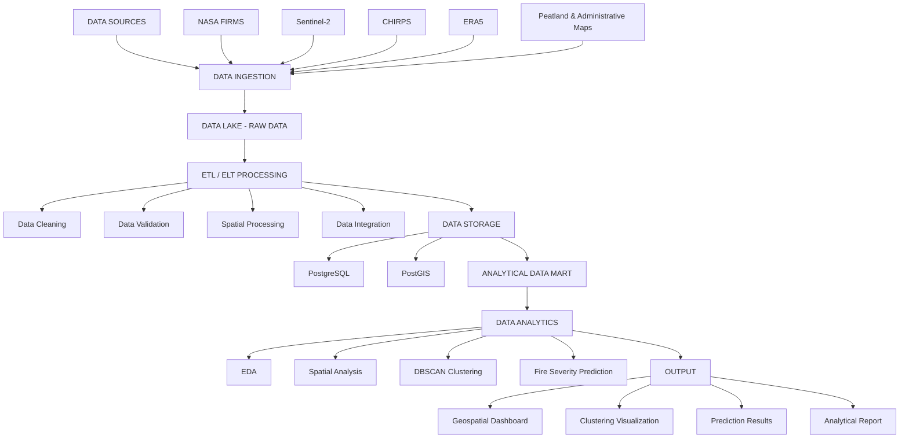

# 🔥 Spatial-Temporal Clustering & Fire Severity Prediction in Peatland Ecosystems of Kalimantan

> **An End-to-End Data Engineering & Data Analytics Project**

## 1. Project Overview

Proyek ini bertujuan untuk menganalisis pola persebaran kebakaran hutan dan lahan (Karhutla) pada ekosistem gambut di Pulau Kalimantan menggunakan pendekatan **Spatial-Temporal Clustering** dan **Fire Severity Prediction**.

Fokus utama penelitian adalah mengidentifikasi pola persebaran titik panas (*hotspots*), menemukan wilayah dengan konsentrasi kebakaran tinggi, menganalisis perubahan aktivitas kebakaran berdasarkan waktu, serta memprediksi tingkat keparahan kebakaran berdasarkan karakteristik lingkungan dan faktor pendukung lainnya.

Penelitian berfokus pada periode **1–30 September 2026**, dengan cakupan lima provinsi di Pulau Kalimantan.

### Research Area

1. Kalimantan Barat
2. Kalimantan Tengah
3. Kalimantan Selatan
4. Kalimantan Timur
5. Kalimantan Utara

### Project Objectives

- Mengintegrasikan berbagai sumber data kebakaran, geospasial, lingkungan, dan cuaca.
- Mengidentifikasi distribusi spasial dan temporal titik panas.
- Menemukan kelompok wilayah yang memiliki konsentrasi kebakaran tinggi menggunakan clustering.
- Menganalisis hubungan antara kondisi lingkungan dan kejadian Karhutla.
- Membangun model machine learning untuk mengklasifikasikan tingkat keparahan kebakaran.
- Menghasilkan visualisasi dan insight yang dapat membantu memahami pola Karhutla di ekosistem gambut.

---

## 2. Project Scope

| Component | Description |
|---|---|
| Domain | Environmental & Disaster Analytics |
| Main Topic | Forest and Land Fires (Karhutla) |
| Ecosystem | Peatland Ecosystem |
| Geographic Scope | 5 Provinces in Kalimantan |
| Main Analysis Period | September 1–30, 2026 |
| Data Engineering | Data Acquisition, ETL/ELT, Data Integration, Data Warehouse |
| Data Analytics | EDA, Spatial Analysis, Temporal Analysis, Clustering |
| Machine Learning | Fire Severity Classification |
| Final Output | Analytical Dataset, Geospatial Analysis, Prediction Model, Dashboard |

**Important Note:** Data historis sebelum September 2026 digunakan untuk membangun dan mengevaluasi model prediksi. September 2026 menjadi periode utama untuk analisis dan pengujian pada proyek ini.

---

# 3. Team Responsibilities & Job Description

## 👨‍💻 A. Data Engineer — Sultan Naufal

**Primary Responsibility:** Building and maintaining the data infrastructure and data pipelines.

Data Engineer bertanggung jawab memastikan seluruh data dari berbagai sumber dapat dikumpulkan, dibersihkan, diintegrasikan, disimpan, dan disiapkan dalam format yang konsisten sehingga dapat digunakan oleh Data Analyst.

### Task Checklist

#### Phase 1 — Data Acquisition

- [ ] Mengidentifikasi sumber data Karhutla dan data pendukung.
- [ ] Mengumpulkan data hotspot dari NASA FIRMS.
- [ ] Mengumpulkan data batas administrasi lima provinsi Kalimantan.
- [ ] Mengumpulkan data peta ekosistem gambut.
- [ ] Mengumpulkan data cuaca dan curah hujan.
- [ ] Mengumpulkan data tutupan lahan dan vegetasi.
- [ ] Mengumpulkan data citra satelit untuk kebutuhan analisis tingkat keparahan kebakaran.
- [ ] Mendokumentasikan sumber, format, dan karakteristik setiap dataset.

#### Phase 2 — Data Processing & Cleaning

- [ ] Melakukan data profiling untuk memahami struktur dan kualitas data.
- [ ] Melakukan penanganan missing values.
- [ ] Menghapus data duplikat.
- [ ] Melakukan validasi koordinat latitude dan longitude.
- [ ] Melakukan standarisasi format tanggal dan waktu.
- [ ] Menyamakan sistem koordinat geospasial (CRS).
- [ ] Melakukan filtering data berdasarkan lima provinsi.
- [ ] Melakukan filtering periode September 2026.
- [ ] Melakukan validasi spasial antara hotspot dan area gambut.
- [ ] Menyusun data quality checks.

#### Phase 3 — ETL/ELT Pipeline Development

- [ ] Membangun pipeline untuk mengambil data dari berbagai sumber.
- [ ] Membuat proses Extract untuk pengambilan data.
- [ ] Membuat proses Transform untuk cleaning dan integrasi.
- [ ] Membuat proses Load untuk menyimpan data ke database.
- [ ] Mengotomatisasi proses pipeline.
- [ ] Membuat logging untuk memantau proses ETL.
- [ ] Menambahkan error handling pada pipeline.
- [ ] Memastikan pipeline dapat dijalankan ulang tanpa menghasilkan duplikasi data.
- [ ] Membuat dokumentasi pipeline.

#### Phase 4 — Database & Data Warehouse

- [ ] Merancang struktur database.
- [ ] Membuat database menggunakan PostgreSQL dan PostGIS.
- [ ] Membuat tabel untuk data hotspot.
- [ ] Membuat tabel untuk data cuaca dan curah hujan.
- [ ] Membuat tabel untuk data gambut.
- [ ] Membuat tabel untuk data administratif.
- [ ] Membuat tabel untuk data kebakaran dan burn severity.
- [ ] Membuat relasi antar tabel.
- [ ] Membuat spatial index untuk mempercepat spatial queries.
- [ ] Membuat analytical dataset yang siap digunakan Data Analyst.

#### Phase 5 — Data Delivery & Documentation

- [ ] Menyediakan dataset final untuk Data Analyst.
- [ ] Membuat data dictionary.
- [ ] Mendokumentasikan skema database.
- [ ] Mendokumentasikan alur ETL.
- [ ] Membuat dokumentasi sumber data.
- [ ] Melakukan validasi akhir dataset.
- [ ] Mengintegrasikan pipeline dan dokumentasi ke GitHub.

**Data Engineer Deliverables:**

1. Raw Data Collection.
2. Cleaned & Integrated Dataset.
3. Automated ETL Pipeline.
4. PostgreSQL + PostGIS Database.
5. Data Warehouse / Analytical Data Mart.
6. Data Dictionary.
7. Pipeline Documentation.
8. Data Quality Report.

---

## 📊 B. Data Analyst — Project Partner

**Primary Responsibility:** Analyzing spatial-temporal patterns, identifying fire clusters, and developing predictive models.

Data Analyst bertanggung jawab mengolah analytical dataset yang telah disediakan Data Engineer untuk menemukan pola, menghasilkan insight, dan membangun model prediksi tingkat keparahan kebakaran.

### Task Checklist

#### Phase 1 — Exploratory Data Analysis (EDA)

- [ ] Memahami struktur analytical dataset.
- [ ] Melakukan analisis distribusi data hotspot.
- [ ] Menganalisis jumlah hotspot berdasarkan provinsi.
- [ ] Menganalisis distribusi kebakaran berdasarkan tanggal.
- [ ] Mengidentifikasi tren aktivitas kebakaran.
- [ ] Menganalisis hubungan hotspot dengan curah hujan.
- [ ] Menganalisis hubungan hotspot dengan suhu dan kelembapan.
- [ ] Menganalisis distribusi hotspot pada area gambut.
- [ ] Membuat visualisasi awal menggunakan Python.

#### Phase 2 — Spatial Analysis

- [ ] Memetakan distribusi hotspot di lima provinsi.
- [ ] Mengidentifikasi wilayah dengan konsentrasi hotspot tertinggi.
- [ ] Melakukan overlay antara hotspot dan peta gambut.
- [ ] Menganalisis persebaran kebakaran berdasarkan wilayah administratif.
- [ ] Mengidentifikasi wilayah rawan kebakaran.
- [ ] Membuat peta distribusi kebakaran menggunakan GeoPandas dan Folium.

#### Phase 3 — Spatial-Temporal Clustering

- [ ] Menentukan variabel untuk proses clustering.
- [ ] Melakukan preprocessing data clustering.
- [ ] Menerapkan algoritma DBSCAN untuk mengidentifikasi kelompok hotspot.
- [ ] Mengevaluasi parameter clustering seperti epsilon dan minimum samples.
- [ ] Mengidentifikasi cluster dengan konsentrasi kebakaran tinggi.
- [ ] Menganalisis perubahan pola cluster berdasarkan waktu.
- [ ] Mengidentifikasi wilayah dengan aktivitas kebakaran berulang.
- [ ] Membuat visualisasi hasil clustering.
- [ ] Menginterpretasikan karakteristik setiap cluster.

#### Phase 4 — Fire Severity Prediction

- [ ] Menentukan target variabel tingkat keparahan kebakaran.
- [ ] Menentukan fitur yang digunakan untuk prediksi.
- [ ] Melakukan feature engineering.
- [ ] Melakukan preprocessing data untuk machine learning.
- [ ] Membagi data training dan testing berdasarkan waktu.
- [ ] Membangun model Random Forest.
- [ ] Membandingkan performa model dengan XGBoost.
- [ ] Melakukan hyperparameter tuning.
- [ ] Mengevaluasi model menggunakan Accuracy, Precision, Recall, F1-Score, dan Confusion Matrix.
- [ ] Melakukan feature importance analysis.
- [ ] Menginterpretasikan hasil prediksi tingkat keparahan kebakaran.

#### Phase 5 — Visualization & Reporting

- [ ] Membuat peta interaktif persebaran hotspot.
- [ ] Membuat visualisasi hasil spatial clustering.
- [ ] Membuat grafik temporal aktivitas kebakaran.
- [ ] Membuat visualisasi distribusi tingkat keparahan kebakaran.
- [ ] Membuat dashboard analisis.
- [ ] Menyusun insight berdasarkan hasil analisis.
- [ ] Menyusun kesimpulan dan rekomendasi.

**Data Analyst Deliverables:**

1. Exploratory Data Analysis Report.
2. Spatial Distribution Analysis.
3. Spatial-Temporal Clustering Results.
4. Fire Severity Prediction Model.
5. Model Evaluation Report.
6. Interactive Geospatial Visualization.
7. Analytical Dashboard.
8. Final Project Report.

---

# 4. Data Sources

Sumber data yang direncanakan untuk digunakan:

| Dataset | Source | Purpose |
|---|---|---|
| Fire Hotspots | NASA FIRMS | Identifikasi titik panas |
| Administrative Boundaries | BIG / GADM | Batas lima provinsi |
| Peatland Distribution | KLHK / BRGM / BIG | Identifikasi ekosistem gambut |
| Rainfall | CHIRPS | Analisis curah hujan |
| Weather Variables | ERA5 / ERA5-Land | Suhu, kelembapan dan variabel cuaca |
| Satellite Imagery | Sentinel-2 | Analisis area terbakar dan burn severity |
| Land Cover | ESA WorldCover | Identifikasi tutupan lahan |

### Data Source Links

- NASA FIRMS: https://firms.modaps.eosdis.nasa.gov/
- Google Earth Engine: https://earthengine.google.com/
- Sentinel-2: https://dataspace.copernicus.eu/
- CHIRPS: https://www.chc.ucsb.edu/data/chirps
- ERA5: https://cds.climate.copernicus.eu/
- BIG: https://tanahair.indonesia.go.id/
- GADM: https://gadm.org/
- ESA WorldCover: https://worldcover2021.esa.int/

*Catatan: Ketersediaan, resolusi, lisensi, dan cakupan temporal setiap dataset harus divalidasi sebelum digunakan. Data peta gambut juga harus menggunakan sumber dan versi yang terdokumentasi.*

---

# 5. Technology Stack

## Data Engineering

| Technology | Usage |
|---|---|
| Python | Main programming language |
| Pandas | Data manipulation |
| GeoPandas | Geospatial data processing |
| Rasterio | Satellite raster processing |
| SQL | Database queries |
| PostgreSQL | Relational database |
| PostGIS | Spatial database extension |
| Apache Airflow / Prefect | Workflow orchestration |
| Git & GitHub | Version control |

## Data Analytics & Machine Learning

| Technology | Usage |
|---|---|
| Python | Data analysis |
| Pandas & NumPy | Data manipulation |
| Matplotlib & Seaborn | Data visualization |
| GeoPandas | Spatial analysis |
| Folium | Interactive maps |
| Scikit-learn | Clustering and machine learning |
| DBSCAN | Spatial clustering |
| Random Forest | Severity classification |
| XGBoost | Model comparison |
| SHAP | Model interpretability |
| Streamlit | Analytical dashboard |

## Supporting Tools

| Tool | Usage |
|---|---|
| Google Earth Engine | Satellite data processing |
| Jupyter Notebook / Google Colab | Experimentation |
| VS Code | Development environment |
| DBeaver | Database management |
| GitHub | Project collaboration |

*Tools yang tercantum merupakan technology stack yang direncanakan. Tidak semua teknologi harus digunakan sekaligus. Airflow dan Prefect, misalnya, merupakan alternatif orchestration.*

---

# 6. System Architecture

The project follows an end-to-end data architecture consisting of five major layers.



### Architecture Explanation

1. **Data Sources:** Mengambil data dari berbagai sumber eksternal seperti NASA FIRMS, Sentinel-2, CHIRPS, dan ERA5.
2. **Data Ingestion:** Mengambil data melalui API, download, atau Google Earth Engine.
3. **Raw Data Storage:** Menyimpan data asli sebelum dilakukan transformasi.
4. **ETL/ELT Processing:** Melakukan cleaning, validasi, standardisasi, dan integrasi data.
5. **Data Storage:** Menyimpan data terintegrasi menggunakan PostgreSQL dan PostGIS.
6. **Analytical Data Mart:** Menyediakan dataset yang sudah terstruktur untuk kebutuhan analisis.
7. **Data Analytics:** Melakukan EDA, spatial-temporal clustering, dan machine learning.
8. **Output:** Menghasilkan dashboard, peta interaktif, hasil prediksi, dan laporan analisis.

---

# 7. Proposed Database Design

Database menggunakan PostgreSQL dengan ekstensi PostGIS untuk mendukung penyimpanan dan pemrosesan data geospasial.

### Proposed Tables

| Table | Description |
|---|---|
| fact_hotspots | Informasi titik panas |
| fact_weather | Informasi kondisi cuaca |
| fact_burned_area | Informasi area terbakar dan burn severity |
| dim_date | Dimensi tanggal |
| dim_location | Informasi provinsi dan kabupaten/kota |
| dim_peatland | Informasi wilayah ekosistem gambut |
| dim_landcover | Informasi tutupan lahan |

### Proposed Data Flow

`Raw Data → Staging → Data Cleaning → Data Integration → PostgreSQL/PostGIS → Analytical Data Mart`

---

# 8. Proposed Analytical Methods

| Method | Purpose | Responsible |
|---|---|---|
| Data Profiling | Memahami kualitas data | Data Engineer |
| ETL/ELT | Mengintegrasikan data | Data Engineer |
| Spatial Overlay | Mengidentifikasi hotspot pada gambut | Shared |
| Exploratory Data Analysis | Memahami karakteristik data | Data Analyst |
| DBSCAN | Mengidentifikasi cluster hotspot | Data Analyst |
| Temporal Analysis | Menganalisis pola waktu kebakaran | Data Analyst |
| Random Forest | Prediksi tingkat keparahan | Data Analyst |
| XGBoost | Model pembanding | Data Analyst |
| SHAP | Interpretasi fitur model | Data Analyst |

---

# 9. Important Methodological Considerations

Agar hasil penelitian dapat dipertanggungjawabkan secara teknis, terdapat beberapa hal yang perlu diperhatikan:

**1. Hotspot is not the same as fire severity.**

Data hotspot NASA FIRMS merupakan deteksi anomali termal, bukan pengukuran langsung tingkat keparahan kebakaran.

Oleh karena itu, diperlukan data tambahan seperti Sentinel-2 untuk menghitung perubahan spektral menggunakan dNBR (Differenced Normalized Burn Ratio) atau pendekatan lain untuk membentuk label tingkat keparahan.

**2. Temporal clustering.**

DBSCAN dapat digunakan untuk mengelompokkan titik berdasarkan koordinat dan waktu. Salah satu pendekatan adalah menggunakan Haversine distance dan membatasi rentang waktu pengamatan.

**3. Prediction target.**

Klasifikasi tingkat keparahan perlu memiliki target yang jelas, misalnya:

- Unburned / No Burn
- Low Severity
- Moderate Severity
- High Severity

Batas klasifikasi harus ditentukan berdasarkan referensi ilmiah dan metode pengukuran yang dipilih.

**4. Model validation.**

Gunakan pembagian data berdasarkan waktu agar tidak terjadi data leakage. Data historis digunakan untuk training dan validasi, sedangkan periode September 2026 dapat digunakan sebagai periode pengujian jika label ground truth tersedia.

**5. Spatial validation.**

Pertimbangkan spatial leakage apabila titik dari area yang sama tersebar ke data training dan testing. Spatial holdout dapat digunakan sebagai evaluasi tambahan.

---

# 10. Repository Structure

```text
karhutla-spatial-temporal-analysis/
│
├── data/
│   ├── raw/
│   │   ├── hotspots/
│   │   ├── weather/
│   │   ├── peatland/
│   │   ├── satellite/
│   │   └── administrative/
│   │
│   ├── processed/
│   └── final/
│
├── data_engineering/
│   ├── ingestion/
│   ├── extraction/
│   ├── transformation/
│   ├── validation/
│   ├── loading/
│   ├── pipelines/
│   └── sql/
│
├── data_analytics/
│   ├── eda/
│   ├── spatial_analysis/
│   ├── temporal_analysis/
│   ├── clustering/
│   ├── modeling/
│   └── evaluation/
│
├── dashboard/
│
├── database/
│   ├── schema/
│   ├── staging/
│   └── analytical_mart/
│
├── docs/
│   ├── architecture/
│   ├── data_dictionary/
│   ├── methodology/
│   └── reports/
│
├── tests/
│   ├── test_pipeline.py
│   └── test_data_quality.py
│
├── requirements.txt
├── .gitignore
└── README.md
```

---

# 11. Project Milestones

Proposed development timeline: **6–8 Weeks**

| Week | Data Engineer | Data Analyst |
|---|---|---|
| 1 | Research data sources and data acquisition | Research methodology and variables |
| 2 | Data ingestion and raw storage | Initial EDA |
| 3 | Data cleaning and transformation | Spatial and temporal analysis |
| 4 | Database and data integration | DBSCAN clustering |
| 5 | Analytical data mart and validation | Feature engineering |
| 6 | Pipeline testing and documentation | Machine learning development |
| 7 | Data delivery and optimization | Model evaluation and dashboard |
| 8 | Final integration | Final analysis and reporting |

---

# 12. Definition of Done

Proyek dinyatakan selesai apabila:

### Data Engineering

- [ ] Semua sumber data utama terdokumentasi.
- [ ] Data berhasil dikumpulkan.
- [ ] Pipeline ETL berhasil dijalankan.
- [ ] Data telah melalui proses cleaning dan validasi.
- [ ] Database PostgreSQL/PostGIS berhasil dibuat.
- [ ] Analytical dataset tersedia.
- [ ] Dokumentasi pipeline selesai.

### Data Analytics

- [ ] EDA selesai.
- [ ] Spatial analysis selesai.
- [ ] Temporal analysis selesai.
- [ ] Clustering berhasil dilakukan dan dievaluasi.
- [ ] Model prediksi berhasil dibangun.
- [ ] Model telah dievaluasi.
- [ ] Dashboard berhasil dibuat.
- [ ] Final analytical report selesai.

### Final Integration

- [ ] Data Engineering dan Data Analytics terintegrasi.
- [ ] Seluruh kode tersedia di GitHub.
- [ ] README dan dokumentasi diperbarui.
- [ ] Hasil proyek dapat direproduksi.

---

# 13. Expected Final Deliverables

Pada akhir proyek, diharapkan tersedia:

1. **End-to-End Data Pipeline:** Pipeline pengumpulan dan pengolahan data Karhutla.
2. **Geospatial Database:** Database spasial menggunakan PostgreSQL dan PostGIS.
3. **Integrated Analytical Dataset:** Dataset terintegrasi dari berbagai sumber.
4. **Spatial-Temporal Clustering:** Identifikasi pola dan kelompok persebaran hotspot.
5. **Fire Severity Prediction:** Model klasifikasi tingkat keparahan kebakaran.
6. **Interactive Dashboard:** Visualisasi distribusi dan pola kebakaran.
7. **Technical Documentation:** Dokumentasi proses Data Engineering dan Data Analytics.
8. **Final Report:** Hasil analisis, evaluasi model, dan kesimpulan penelitian.

---

## 14. Team

| Name | Role | Main Responsibility |
|---|---|---|
| Sultan Naufal | Data Engineer | Data Infrastructure, ETL/ELT, Database, Data Integration |
| Project Partner | Data Analyst | EDA, Spatial Analysis, Clustering, Machine Learning, Visualization |

---

**Project Status:** 🚧 In Progress

**Project Domain:** Environmental Data Engineering & Geospatial Analytics

**Project Period:** September 2026 (Main Analysis Period)

**Project Location:** Kalimantan, Indonesia

**Project Goal:** Building an end-to-end data solution to analyze spatial-temporal fire patterns and predict fire severity in Kalimantan's peatland ecosystems.