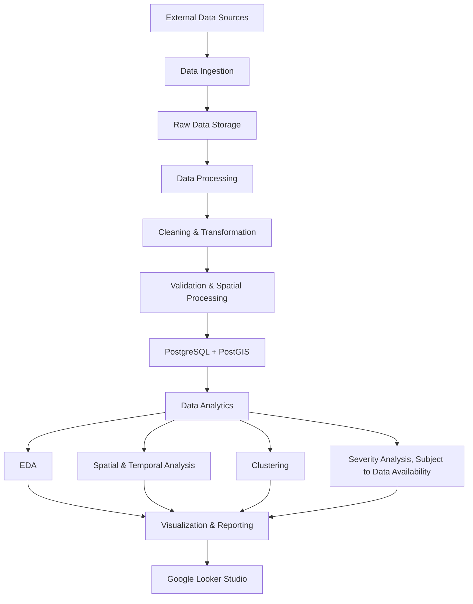

# Spatial-Temporal Clustering & Fire Severity Prediction in Peatland Ecosystems of Kalimantan

**An End-to-End Data Engineering & Geospatial Analytics Project**

## 1. Project Overview

This project aims to analyze the spatial and temporal patterns of forest and land fires (Karhutla) across peatland ecosystems in Kalimantan, Indonesia.

The study explores hotspot distribution, spatial clustering, temporal patterns, and environmental factors associated with fire activity. It also investigates the potential for fire severity analysis and predictive modeling, subject to the availability of reliable ground-truth data.

The project integrates geospatial, fire detection, peatland, and rainfall datasets into a spatial database to support downstream analytical workflows.

**Main Analysis Period:** September 1–30, 2026

### Research Area

The study covers five provinces in Kalimantan:

- West Kalimantan
- Central Kalimantan
- South Kalimantan
- East Kalimantan
- North Kalimantan

### Project Objectives

- Collect and integrate fire, geospatial, and environmental datasets.
- Analyze spatial and temporal hotspot distribution.
- Identify areas with concentrated fire activity.
- Explore relationships between environmental conditions and fire occurrence.
- Investigate fire severity analysis and prediction where valid target data are available.
- Deliver processed datasets and geospatial database resources for analysis.

---

## 2. Project Scope

| Component | Description |
|---|---|
| Domain | Environmental Data Engineering & Geospatial Analytics |
| Main Topic | Forest and Land Fires (Karhutla) |
| Ecosystem | Peatland Ecosystem |
| Geographic Scope | Five Provinces in Kalimantan |
| Main Analysis Period | September 1–30, 2026 |
| Data Engineering | Acquisition, Processing, Integration, ETL, Database Management |
| Data Analytics | EDA, Spatial Analysis, Temporal Analysis, Clustering |
| Machine Learning | Fire Severity Classification, subject to target data availability |
| Dashboard | Google Looker Studio |
| Database | PostgreSQL + PostGIS |
| Final Output | Processed datasets, geospatial database, analytical results, dashboard, and documentation |

Historical data may be considered for model development if suitable target labels and supporting variables are available. September 2026 serves as the primary study period.

---

## 3. Team Responsibilities

### A. Data Engineer — Sultan Naufal

**Primary Responsibility:** Data acquisition, processing, integration, database management, and data delivery.

- Research and evaluate data sources.
- Develop data ingestion scripts.
- Perform data profiling, cleaning, and transformation.
- Handle missing values, duplicates, and data inconsistencies where applicable.
- Validate attributes, dates, coordinates, and geometries.
- Perform spatial processing and filtering based on the study area.
- Design and implement PostgreSQL/PostGIS database structures.
- Develop database loading scripts.
- Manage database constraints, relationships, and spatial indexes.
- Maintain data dictionary and technical documentation.
- Prepare database backups and verify restoration.
- Deliver processed datasets and database access to the Data Analyst.

**Status: Completed for the current Data Engineering scope.**

### B. Data Analyst — Daniel Putra

**Primary Responsibility:** Exploratory analysis, spatial-temporal analysis, clustering, modeling, and visualization.

#### Exploratory Data Analysis
- Examine dataset structure and characteristics.
- Analyze hotspot distribution by province.
- Explore temporal fire activity.
- Investigate relationships between hotspots and environmental variables.

#### Spatial Analysis
- Map hotspot distribution.
- Identify areas with concentrated fire activity.
- Overlay hotspots with peatland areas.
- Analyze spatial distribution by administrative region.

#### Spatial-Temporal Clustering
- Determine clustering variables.
- Perform preprocessing.
- Explore DBSCAN and appropriate distance metrics.
- Evaluate clustering parameters.
- Interpret spatial and temporal clustering patterns.

#### Fire Severity Analysis & Prediction
- Assess target data availability and validity.
- Develop relevant features.
- Perform feature engineering.
- Develop classification models when reliable target labels are available.
- Evaluate and interpret model performance.

#### Visualization & Reporting
- Create spatial and temporal visualizations.
- Present clustering results.
- Develop a Google Looker Studio dashboard.
- Prepare analytical insights and final reporting.

### Shared Responsibilities

- Agree on data requirements and formats.
- Integrate Data Engineering and Data Analytics outputs.
- Validate analytical results and data consistency.
- Prepare final project documentation and presentation.

---

## 4. Data Sources

| Dataset | Source | Purpose | Status |
|---|---|---|---|
| Fire Hotspots | NASA FIRMS | Fire detection analysis | Processed & loaded |
| Administrative Boundaries | BIG | Study area boundaries | Processed & loaded |
| Peatland Distribution | BNPB InAWARE / Global Forest Watch | Peatland spatial analysis | Processed & loaded |
| Rainfall | CHIRPS | Environmental analysis | Downloaded & processed |
| Satellite Imagery Metadata | Copernicus Data Space / Sentinel-2 | Imagery selection and spatial coverage | Metadata processed |
| Weather Variables | ERA5 / ERA5-Land | Additional environmental analysis | Not implemented |
| Land Cover | ESA WorldCover | Land cover analysis | Not implemented |

### Data Source Links

- NASA FIRMS: https://firms.modaps.eosdis.nasa.gov/
- BNPB GIS: https://gis.bnpb.go.id/
- Copernicus Data Space: https://dataspace.copernicus.eu/
- CHIRPS: https://www.chc.ucsb.edu/data/chirps
- ERA5: https://cds.climate.copernicus.eu/
- BIG: https://tanahair.indonesia.go.id/
- GADM: https://gadm.org/
- ESA WorldCover: https://worldcover2021.esa.int/

### Data Source Notes

**NASA FIRMS**

Hotspot data were obtained from VIIRS Suomi-NPP near-real-time detections. The original dataset covers September–October 2026 and was filtered to the September study period and the defined geographic study area.

Hotspot detections indicate thermal anomalies and are not direct measurements of burned area or fire severity.

**Administrative Boundaries**

Administrative boundary data from BIG were processed to represent the five provinces included in the study.

**Peatland Distribution**

The peatland dataset was obtained from the `Indonesia_peat_lands` layer associated with BNPB InAWARE / Global Forest Watch. It was used as an alternative to the peatland mapping service investigated earlier that required authentication.

The source data were retrieved using a Kalimantan bounding box and were not clipped to provincial boundaries. Attribute definitions, source updates, and spatial accuracy should be considered during interpretation.

**CHIRPS**

Daily rainfall rasters for September 2026 were downloaded and retained as GeoTIFF files. Raster files remain on disk, while their metadata and file references are stored in PostgreSQL.

**Sentinel-2**

Sentinel-2 L2A product metadata and spatial footprints were collected for September 2026. The actual satellite imagery pixels have not yet been downloaded or processed for burned-area or severity analysis.

Not all proposed datasets are required for the final analysis. Additional sources will depend on analytical requirements and data availability.

---

## 5. Data Engineering Progress

The Data Engineering component has completed the initial acquisition, processing, integration, database implementation, and data delivery preparation for the five datasets listed below.

### A. Administrative Boundaries

| Attribute | Result |
|---|---|
| Source | BIG |
| Geographic Coverage | Five Kalimantan Provinces |
| Number of Provinces | 5 |
| CRS | EPSG:4326 |
| Geometry Type | MultiPolygon |
| Database Table | `karhutla.dim_provinces` |
| Status | Processed, loaded & validated |

### B. NASA FIRMS Hotspots

| Attribute | Result |
|---|---|
| Source | NASA FIRMS |
| Satellite | Suomi-NPP |
| Instrument | VIIRS |
| Product Version | 2.0NRT |
| Raw Records | 210,915 |
| Raw Date Range | September–October 2026 |
| September Records | 115,739 |
| Records Within Study Area | 115,137 |
| Unmatched Records | 602 |
| CRS | EPSG:4326 |
| Database Table | `karhutla.fact_hotspots` |
| Status | Processed, loaded & validated |

The 602 unmatched records are retained separately for inspection. They are not automatically classified as detections outside Indonesia.

### C. Peatland Dataset

| Attribute | Result |
|---|---|
| Source | BNPB InAWARE / Global Forest Watch |
| Layer | `Indonesia_peat_lands` |
| Raw Features | 350 |
| Geometry Types | Polygon and MultiPolygon |
| CRS | EPSG:4326 |
| Valid Geometries | 350 |
| Unique Features | 350 |
| Normalized Category | 348 peatland, 2 unknown |
| Province Relationships | 353 |
| Database Table | `karhutla.dim_peatlands` |
| Status | Processed, loaded & validated |

Peatland features were not clipped to provincial boundaries. The province relationship dataset records spatial intersections between peatland features and administrative boundaries. Three peatland features intersect multiple provinces, resulting in 353 relationships from 350 unique features.

### D. CHIRPS Rainfall Data

| Attribute | Result |
|---|---|
| Source | CHIRPS |
| Data Type | Daily Raster |
| Period | September 1–30, 2026 |
| Raster Files | 30 |
| CRS | EPSG:4326 |
| Raster Dimensions | 210 × 188 pixels |
| Number of Bands | 1 |
| Spatial Resolution | 0.05° |
| NoData Value | -9999 |
| Storage | GeoTIFF |
| Database Table | `karhutla.chirps_raster_metadata` |
| Status | Downloaded, processed & metadata loaded |

Raster pixels remain stored in GeoTIFF files. PostgreSQL contains metadata and file references rather than raster pixel values.

### E. Sentinel-2 Data

| Attribute | Result |
|---|---|
| Source | Copernicus Data Space |
| Satellite | Sentinel-2 |
| Instrument | MSI |
| Processing Level | L2A |
| Period | September 1–30, 2026 |
| Product Footprints | 214 |
| Geometry Type | Polygon |
| CRS | EPSG:4326 |
| Average Product Cloud Cover | 16.67% |
| Database Table | `karhutla.sentinel2_products` |
| Status | Metadata and footprints processed, loaded & validated |

The current implementation contains product metadata and spatial footprints only. The imagery pixels have not been downloaded or processed.

### F. Database Implementation

| Attribute | Result |
|---|---|
| Database | `karhutla_db` |
| DBMS | PostgreSQL 18.6 |
| Spatial Extension | PostGIS 3.7.0 |
| Schema | `karhutla` |
| Number of Tables | 5 |
| Total Records | 115,736 |
| Spatial Reference System | EPSG:4326 |
| Spatial Index | GiST |
| Backup Format | PostgreSQL Custom Format |
| Status | Implemented & validated |

#### Database Tables

| Table | Records |
|---|---:|
| `dim_provinces` | 5 |
| `dim_peatlands` | 350 |
| `fact_hotspots` | 115,137 |
| `sentinel2_products` | 214 |
| `chirps_raster_metadata` | 30 |
| **Total** | **115,736** |

### G. Database & Data Validation

- All 115,137 hotspot records have valid province references.
- No invalid province references were identified.
- All 115,706 spatial features have valid geometries.
- Spatial tables use EPSG:4326.
- GiST spatial indexes are implemented for all four spatial tables.
- Database backup was created using PostgreSQL custom format.
- Restoration testing was successfully completed on a temporary database.
- Restored table counts and PostGIS configuration were verified.

### Data Engineering Summary

| Dataset | Processing | Database Loading | Validation |
|---|---|---|---|
| Administrative Boundaries | Completed | Completed | Passed |
| NASA FIRMS | Completed | Completed | Passed |
| Peatland | Completed | Completed | Passed |
| CHIRPS | Completed | Completed | Passed |
| Sentinel-2 Metadata | Completed | Completed | Passed |
| ERA5 / Weather | Not implemented | Not implemented | Not applicable |
| Land Cover | Not implemented | Not implemented | Not applicable |

**Data Engineering Status: Completed for the current project scope.**

---

## 6. Technology Stack

### Data Engineering

| Technology | Purpose |
|---|---|
| Python | Data acquisition and processing |
| Pandas | Tabular data manipulation |
| NumPy | Numerical operations |
| GeoPandas | Geospatial processing |
| Shapely | Geometry operations |
| Requests | Data acquisition |
| Rasterio | Raster data processing |
| SQL | Database queries |
| PostgreSQL | Relational database |
| PostGIS | Geospatial database extension |
| Git & GitHub | Version control |

### Data Analytics & Machine Learning

| Technology | Purpose |
|---|---|
| Python | Data analysis |
| Pandas & NumPy | Data manipulation |
| GeoPandas | Spatial analysis |
| Scikit-learn | Clustering and machine learning |
| DBSCAN | Spatial clustering |
| Random Forest | Candidate classification model |
| XGBoost | Candidate model comparison |
| Matplotlib / Seaborn | Visualization |
| Folium | Interactive maps |

### Dashboard & Supporting Tools

| Tool | Purpose |
|---|---|
| Google Looker Studio | Dashboard development |
| Google Sheets | Supporting data source, if needed |
| VS Code | Development environment |
| DBeaver | Database management |
| QGIS | Geospatial inspection |
| Jupyter Notebook / Google Colab | Data exploration and experimentation |

---

## 7. System Architecture

The project follows a batch data workflow. External datasets are acquired, stored, processed, validated, and loaded into PostgreSQL/PostGIS for downstream analysis.



### Architecture Status

The Data Engineering workflow has been implemented for administrative boundaries, FIRMS hotspots, peatland data, CHIRPS raster metadata, and Sentinel-2 product metadata and footprints.

The processed datasets are stored in PostgreSQL/PostGIS or maintained as external files with database metadata references where appropriate.

The Data Engineering deliverables have been prepared for use by the Data Analyst.

---

## 8. Database Design & Implementation

The project uses PostgreSQL 18.6 with PostGIS 3.7.0.

- Database: `karhutla_db`
- Schema: `karhutla`

### Implemented Tables

| Table | Description |
|---|---|
| `karhutla.dim_provinces` | Administrative boundaries of five Kalimantan provinces |
| `karhutla.dim_peatlands` | Peatland polygon features and source attributes |
| `karhutla.fact_hotspots` | NASA FIRMS hotspot detections |
| `karhutla.sentinel2_products` | Sentinel-2 product metadata and spatial footprints |
| `karhutla.chirps_raster_metadata` | Metadata and file references for CHIRPS rainfall rasters |

### Database Features

- Primary keys and unique constraints.
- Foreign key relationships between hotspots and provinces.
- Geometry columns using EPSG:4326.
- GiST spatial indexes.
- B-tree indexes for selected attributes.
- Check constraints for applicable fields.
- PostgreSQL custom-format database backup.
- Verified database restoration.

### Data Storage Strategy

Vector datasets are stored in PostGIS geometry columns.

CHIRPS rainfall rasters remain as GeoTIFF files on disk. PostgreSQL stores their metadata and file references.

Sentinel-2 imagery pixels are not stored. Only product metadata and spatial footprints are currently available in the database.

For database connection instructions, schema details, sample queries, and restoration procedures, refer to the database documentation and analysis handover files.

---

## 9. Proposed Analytical Methods

The Data Analytics workflow is conducted by the Data Analyst using the processed datasets delivered by Data Engineering.

| Method | Purpose | Responsible |
|---|---|---|
| Data Profiling | Understand data characteristics and quality | Shared |
| Exploratory Data Analysis | Explore distribution and trends | Data Analyst |
| Spatial Overlay | Explore hotspot and peatland intersections | Data Analyst |
| Spatial Analysis | Analyze geographic fire patterns | Data Analyst |
| Temporal Analysis | Analyze fire activity over time | Data Analyst |
| DBSCAN | Identify spatial or spatial-temporal clusters | Data Analyst |
| Random Forest | Candidate classification model | Data Analyst |
| XGBoost | Candidate model comparison | Data Analyst |

The final analytical methods will depend on data availability, feature quality, research objectives, and model evaluation results.

---

## 10. Important Methodological Considerations

### 1. Hotspot Detection vs. Fire Severity

NASA FIRMS hotspots represent thermal detections, not direct measurements of burned area or fire severity.

Fire severity analysis requires additional data and a defensible methodology for deriving target labels, such as satellite-based burned-area or vegetation-change indicators.

### 2. Peatland Dataset Limitations

The peatland dataset is an alternative layer obtained from BNPB InAWARE / Global Forest Watch. It should not be assumed to be equivalent to a specific official peatland map at a different scale or accuracy.

Source attributes, update year, and spatial accuracy should be considered during interpretation.

### 3. Spatial-Temporal Clustering

Clustering methods must account for spatial coordinates and temporal characteristics. Distance metrics, scaling, and parameters should be selected based on the analytical objective.

### 4. Severity Prediction

Severity prediction should only be developed when valid target labels and relevant features are available. Hotspot detections alone should not be treated as severity labels.

### 5. Model Validation

Temporal characteristics should be considered when splitting datasets for model evaluation to reduce data leakage and ensure appropriate validation.

### 6. Data Availability

Data availability, spatial resolution, temporal coverage, and source quality may limit the analyses that can be conducted.

---

## 11. Repository Structure

```text
karhutla-spatial-temporal-analysis/
├── README.md
├── requirements.txt
├── .gitignore
├── LICENSE
│
├── dashboard/
│   ├── README.md
│   └── exports/
│
├── data/
│   ├── raw/
│   │   ├── boundaries/
│   │   ├── chirps/
│   │   ├── firms/
│   │   ├── peatland/
│   │   └── sentinel2/
│   ├── staging/
│   │   └── sentinel2/
│   ├── processed/
│   │   ├── boundaries/
│   │   ├── chirps/daily/
│   │   ├── firms/
│   │   └── peatland/
│   └── final/
│
├── database/
│   ├── backup/
│   ├── schema/
│   └── README.md
│
├── data_engineering/
│   ├── ingestion/
│   ├── transformation/
│   └── database/
│       ├── scripts/
│       └── db_config.py
│
├── data_analytics/
│   ├── notebooks/
│   ├── clustering/
│   ├── modeling/
│   ├── evaluation/
│   └── visualization/
│
├── docs/
│   ├── analysis_handover/
│   ├── data_dictionary/
│   └── reports/
│
└── tests/
```

### Directory Description

| Directory | Description |
|---|---|
| `data/raw/` | Original datasets collected from external sources |
| `data/staging/` | Intermediate datasets prepared for processing |
| `data/processed/` | Cleaned, transformed, and validated datasets |
| `data/final/` | Datasets prepared for analytical consumption, if applicable |
| `database/schema/` | SQL schema definitions |
| `database/backup/` | PostgreSQL database backups |
| `data_engineering/ingestion/` | Data acquisition scripts |
| `data_engineering/transformation/` | Data cleaning and transformation scripts/notebooks |
| `data_engineering/database/scripts/` | Python database loading scripts |
| `data_analytics/` | Analytics notebooks, clustering, modeling, evaluation, and visualization |
| `dashboard/` | Dashboard development resources and exports |
| `docs/analysis_handover/` | Data Engineering to Data Analytics documentation |
| `docs/data_dictionary/` | Dataset definitions and column documentation |
| `docs/reports/` | Technical documentation and project progress reports |
| `tests/` | Test scripts, when implemented |

---

## 12. Project Milestones

| Phase | Data Engineer | Data Analyst |
|---|---|---|
| 1. Research | Data source research | Methodology research |
| 2. Acquisition | Data ingestion | Initial exploration |
| 3. Processing | Cleaning & transformation | EDA & spatial analysis |
| 4. Database | Database implementation | Clustering |
| 5. Integration | Data delivery & handover | Feature engineering |
| 6. Analysis | Support data requirements | Clustering & modeling |
| 7. Visualization | Data support | Dashboard development |
| 8. Finalization | Documentation complete | Evaluation & reporting |

The Data Engineering phase has been completed for the current scope. Data Analytics and final project integration remain in progress.

---

## 13. Definition of Done

### Data Engineering

- [x] Data sources identified and documented.
- [x] Administrative boundaries acquired and processed.
- [x] FIRMS data acquired and processed.
- [x] Peatland data acquired and processed.
- [x] CHIRPS data acquired and processed.
- [x] Sentinel-2 metadata and footprints acquired and processed.
- [x] Data profiling and validation performed.
- [x] PostgreSQL database implemented.
- [x] PostGIS configured.
- [x] Database schema implemented.
- [x] Processed data loaded into database.
- [x] Relationships and foreign key integrity validated.
- [x] Spatial geometries and CRS validated.
- [x] Spatial indexes implemented.
- [x] Database backup created.
- [x] Database restoration tested.
- [x] Data dictionary and documentation completed.
- [x] Data delivery and handover completed.

### Data Analytics

- [ ] EDA completed.
- [ ] Spatial analysis completed.
- [ ] Temporal analysis completed.
- [ ] Clustering conducted and evaluated.
- [ ] Fire severity analysis conducted, subject to data availability.
- [ ] Predictive model developed, if valid target data are available.
- [ ] Dashboard completed.
- [ ] Analytical report completed.

### Final Integration

- [ ] Data Engineering and Data Analytics outputs integrated.
- [ ] Code and documentation maintained in GitHub.
- [ ] Analytical workflow reproducibility reviewed.
- [ ] Final project results validated.

---

## 14. Expected Final Deliverables

1. Processed and documented datasets.
2. PostgreSQL + PostGIS geospatial database.
3. Data Engineering documentation and data dictionary.
4. Spatial-temporal clustering results.
5. Fire severity analysis and prediction, subject to data availability.
6. Google Looker Studio dashboard.
7. Final analytical report.
8. Project presentation.

---

## 15. Team

| Name | Role | Main Responsibility |
|---|---|---|
| Sultan Naufal | Data Engineer | Data Acquisition, Processing, ETL, Database, Data Integration |
| Daniel Putra | Data Analyst | EDA, Spatial Analysis, Clustering, Machine Learning, Visualization |

---

**Project Status:** In Progress  
**Data Engineering Status:** Completed  
**Data Analytics Status:** In Progress  
**Project Domain:** Environmental Data Engineering & Geospatial Analytics  
**Main Analysis Period:** September 2026  
**Project Location:** Kalimantan, Indonesia

**Project Goal:** Developing a geospatial data solution to analyze spatial-temporal fire patterns and investigate fire severity in peatland ecosystems across Kalimantan.
